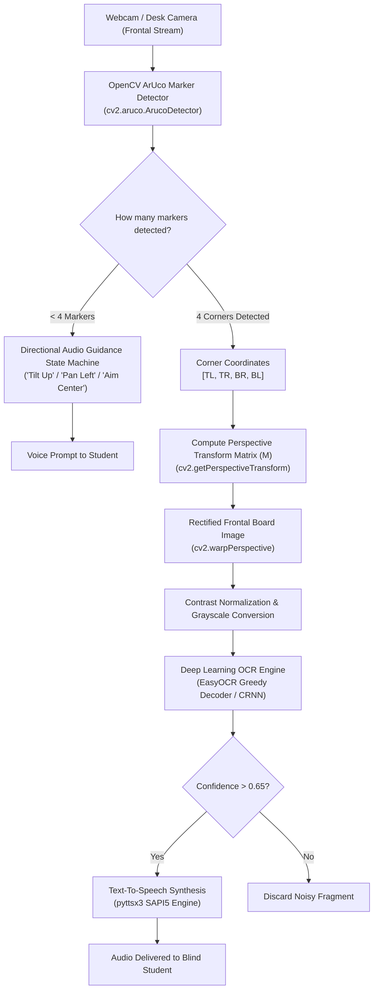

# Real-Time Assistive Classroom Blackboard OCR & Navigation for Visually Impaired Students

[](https://www.python.org/)
[](https://opencv.org/)
[](https://github.com/JaidedAI/EasyOCR)
[](https://github.com/nateshmbhat/pyttsx3)
[](https://youtu.be/5D6ct6-0fJo)

An end-to-end assistive vision pipeline engineered to solve one of the greatest educational barriers for visually impaired children in mainstream classrooms: **reading chalkboard/whiteboard text and navigating school hallways in real time**.

---

## 🎯 Problem Statement

Children with low vision or blindness attending standard schools are frequently excluded from active learning because teachers write formulas, exercises, and assignments on blackboards. 

Standard OCR systems fail when applied to raw classroom video feeds because:
1. **Severe Perspective Distortion:** The student sits at an oblique angle relative to the blackboard.
2. **Aiming Impossibility:** Visually impaired students cannot visually align a handheld or desk camera to frame the board.
3. **Lighting & Contrast Variations:** Chalk on slate or dry-erase markers have low and inconsistent contrast.

---

## 💡 Technical Solution

This project implements an intelligent two-stage computer vision system:
1. **ArUco Marker Board Boundary Localization:** Four fiducial ArUco markers (DICT_4X4_50) are fixed to the corners of the classroom board.
2. **Directional Camera Aiming Guidance:** An acoustic feedback state machine detects which markers are missing from the camera's field of view and synthesizes immediate verbal corrective instructions ("Tilt Up", "Tilt Down", "Pan Left", "Pan Right") to guide the student's camera aim.
3. **Homography & Perspective Rectification:** When all 4 corners are acquired, a perspective transform matrix $M$ warps the skewed polygon into a flat, high-contrast rectangular frontal image.
4. **Deep Learning OCR (EasyOCR / CRNN):** Character recognition with contrast enhancement and confidence filtering ($\text{conf} > 0.65$).
5. **Instant Offline Text-To-Speech (pyttsx3):** Speaks recognized text through earphones immediately.
6. **Dual Mode - Indoor Navigation:** When walking between classes, the student can switch to Navigation Mode: corridor ArUco markers announce upcoming rooms (Canteen, Classrooms, Restrooms) in multiple languages (Russian and Kazakh).

---

## 🔬 System Pipeline Architecture



---

## 🎥 Live Demonstration Video

[](https://youtu.be/5D6ct6-0fJo)

> **▶️ [Click to watch the full demonstration on YouTube](https://youtu.be/5D6ct6-0fJo)**  
> Demonstrates real-time ArUco marker tracking, dynamic homography rectification, OCR confidence filtering, and instant offline speech synthesis for visually impaired students.  
> *(Local copy also available in repo: `OCR_MODEL_REALTIME.mp4`)*

---

## 🚀 Installation & Usage

### 1. Requirements
```bash
git clone https://github.com/ViktorBuild/realtime-classroom-ocr.git
cd realtime-classroom-ocr
pip install -r requirements.txt
```

### 2. Print & Place Markers
Print 4 ArUco markers from the `DICT_4X4_50` dictionary (IDs: 0, 1, 2, 3) and affix them to the 4 corners of the board.

### 3. Run Application
```bash
python classroom_board_reader.py
```
- Press `z` to toggle between **Board OCR Mode** and **Indoor Navigation Mode**.
- Press `q` or `ESC` to exit.

---

## 📁 Repository Structure

```
05_realtime_classroom_ocr/
├── classroom_board_reader.py  # Clean unified production application
├── arucoSearch.py             # Research script with directional audio state machine
├── ocr.py                     # Standalone OCR evaluation script
├── trial.py                   # Perspective transform experiments
├── tts.py                     # Offline Text-To-Speech test wrapper
├── OCR_MODEL_REALTIME.mp4     # Full live demonstration video
├── requirements.txt           # Python dependencies
└── Handwritten-Text-Recognition-in-Real-Time-master/ # CRNN offline model training library
```

---

## 👤 Author
**Viktor** ([@ViktorBuild](https://github.com/ViktorBuild))  
Assistive Computer Vision & EdTech Engineering
